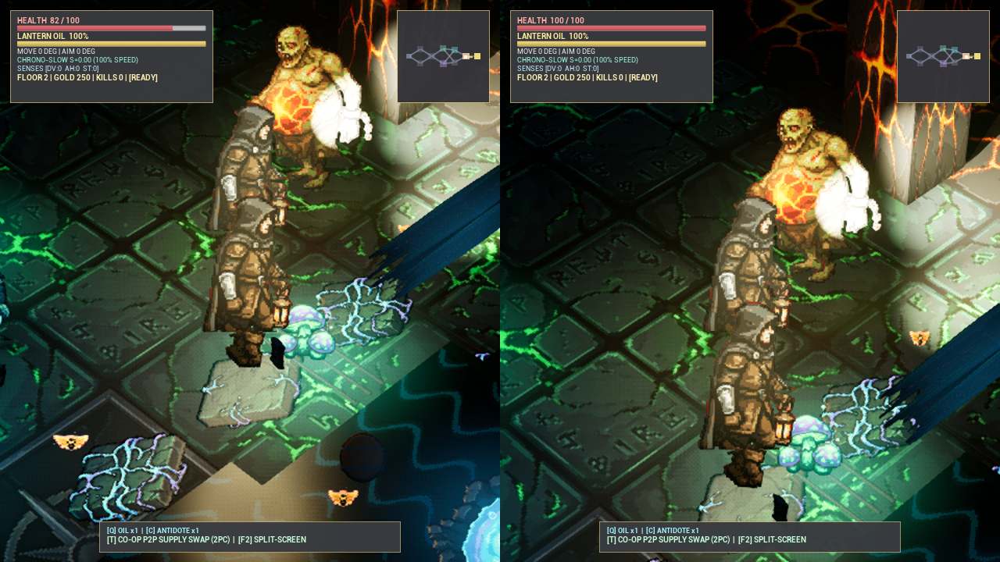

# Dark Dungeoneer

A top-down 2.5D co-op roguelite hack-and-slash, built in Unreal Engine 5.8 with C++20.

You are the lamplighter of a village whose mornings are being stolen by a city sealed under the hill.
You go down into the dark with the one lantern that can cut it, fight through reshuffling floors of
restless dead, die, wake at the top of the stair, and go down again. A second player can join on the
same screen at any time.

- **Design:** [docs/DESIGN.md](docs/DESIGN.md) — moves, skills, enemies, run structure, controls, known gaps
- **Story:** [docs/STORY.md](docs/STORY.md) — world, characters, endings, in-game text
- **Agent/dev rules:** [AGENTS.md](AGENTS.md) — build/test commands and the hard rules
- **History:** [CHANGELOG.md](CHANGELOG.md); older plans and devlogs are in [docs/archive/](docs/archive/)



## What's in it

- **Combat:** a 4-hit lantern combo, hold-to-charge heavy smash, dodge roll with a dash-strike follow-up,
  perfect dodges, parries that stun attackers and bat thrown flasks back, and two skill slots filled by
  scrolls found during a run (fire flask, grapple hook, blink-backstab, spin, radial flash, decoy).
- **Darkness:** the lantern lights a cone; oil fuels it. Senses (dark vision, hearing ripples, scent trails)
  are upgraded at sanctuary altars.
- **Dungeon:** three seeded floors (Sunken Crypt, Spore Fens, Cinder Kiln) plus mirror-palace mazes with
  false walls, vendors, sanctuaries, a vault and the Cinder Colossus boss.
- **Enemies:** noise-hunting Exploders, Throwers that steal your speed with chrono gas, invisible Mirror
  Stalkers.
- **Living world:** water you wade through, flowers that bloom in light, moths and newts that scatter.
- **Co-op:** a drop-in second player on the same screen (shared camera with a leash), revives, a shared stash, supply swaps; online sessions through the
  OnlineSubsystem (Null by default).

Everything, including widgets and materials, is built from C++. Art is pixel-art sprite sheets on
camera-facing planes, sliced into normal/ORM/emissive maps at import.

## Requirements

- Unreal Engine 5.8 (the scripts assume `D:\epuc\UE_5.8`)
- Visual Studio 2022 or Build Tools with the C++ workload and a Windows 10/11 SDK
- Python 3.10+ for the checks and asset scripts

## Build and run

```powershell
& "D:\epuc\UE_5.8\Engine\Build\BatchFiles\Build.bat" DarkDungeoneerEditor Win64 Development "$PWD\DarkDungeoneer.uproject" -waitmutex -NoHotReload
```

```powershell
.\Launch-DarkDungeoneer.bat
```

The launcher runs a packaged build if one exists, otherwise the editor in `-game` mode.
Useful flags: `-AutoPlaySolo` (skip the menu), `-AutoCoop`, `-StartFloor=2`, `-StartRoom=Combat`.

## Checks

```powershell
python scripts/verify_architecture_invariants.py
```

```powershell
& "D:\epuc\UE_5.8\Engine\Binaries\Win64\UnrealEditor-Cmd.exe" "$PWD\DarkDungeoneer.uproject" -ExecCmds="Automation RunTests DarkDungeoneer; Quit" -unattended -nop4 -nosplash -NullRHI -stdout -FullStdOutLogOutput
```

## Controls (player 1)

WASD move · mouse aim · LMB attack (hold to smash) · Shift roll · L parry · Q / R skills · F interact ·
1 / C oil and antidote · T swap supplies with partner · F2 add player 2. Gamepads work for both players.
Full table in [docs/DESIGN.md](docs/DESIGN.md#controls-summary).

## Layout

```text
Config/      engine, game and input settings
Content/     sprite sheets, audio, generated .uassets, AssetManifest.json (asset hashes)
Shaders/     PixelLit25D.ush
Source/      game module (see AGENTS.md for the folder map) and automation tests
docs/        design, story, art specs, screenshots, archive
scripts/     static checks, foley and art synthesis
.claude/     agent skills (sprite slicing, dungeon gen, AI, audio)
```
