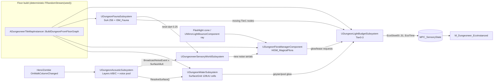

# Living Ecosystem: Tiered Light, Flora, Fauna, Hydrology & Acoustics (`v1.2.0`)

Add five connected C++20 systems: `UDungeonLightBudgetSubsystem`, `UDungeonFloraManagerComponent`, `UDungeonFaunaSubsystem`, `UDungeonWaterSubsystem` and `UDungeonAcousticSubsystem`. Also extend the asset pipeline (`slice_normal_rig.py --mode eco`, `TO_GENERATE_ECOSYSTEM.md`, procedural foley). All of it must stay inside the Intel HD 520 draw-call budget and the zero-allocation hot-path rules.

---

## Research Findings That Shape This Plan

| # | Finding (observed in code/assets) | Consequence |
|---|---|---|
| F1 | Every HISM gets its material from `CreateDungeonOrRigMaterial`, which wraps **stock engine materials** (`M_Shader_SimpleMaskedTwoSided`, `M_ES_Phong_Masked_Master_2sided`, `BasicShapeMaterial`). None of them read `PerInstanceCustomData` or `MPC_SensoryState`. | The current `SetCustomDataValue` writes are bookkeeping only. Tier 0 emissive, Tier 1 glow pools and per-instance UV cells **will not render** unless we add a material that reads them (see **Decision D1**). |
| F2 | `ADungeoneerCharacter` and `AZombieBase` advance walk columns in their own `AdvanceWalkFlipbookByDistance`. Neither uses `U25DAnimOrchestratorComponent`, so in-game `OnFootstepContact` never fires. | The acoustic engine needs a column-transition hook on the hero and zombies (**Decision D2**). |
| F3 | The reference sheets are actually `Content/Art/Ecosytem/*.jpg` (folder name misspelled), 2048², with a near-`#FB00FE` background (JPEG noise σ≈1). | The slicer needs JPG input and a tolerance key. |
| F4 | The Prism-Lily (flora row 0) **is magenta**. The existing global fringe rule would erase 23,909 of 133,822 subject pixels in the full-bloom cell (~18%). | Eco mode must use **border-connected flood-fill keying**, not a global color key. |
| F5 | Stray AI stamps sit in the sheets: a "hand holding a vial" in flora R1C2, water R0C2 and water R3C2, and a boot in water R0C0. | Add deterministic per-cell erase rectangles (`eco_cleanup_masks.json`). |
| F6 | The AI pixel-block period is about 4–5.3 px, so a 512 px cell holds about 128 native pixels. | Nearest-downsample cells to **128×128** (a 2 m footprint at 64 px/m). Fauna get a separate **32 px strip** (see D5). |
| F7 | `verify_architecture_invariants.py` bans `FTimerHandle`, `GetAllActorsOfClass` and `GetFirstPlayerController`, plus `SpawnActor`, `NewObject` and `CreateDynamicMaterialInstance` inside `Tick` bodies. | Drip timers use fixed-step accumulators. All pools are allocated at floor build. |
| F8 | The repo has no Niagara system assets, MetaSound graphs or foley WAVs. `ImportAllVoiceStemsFromDisk` already turns WAV files into `USoundWave`. | Use pooled ISM micro-particles instead of Niagara, plus generated WAV foley played through pooled `UAudioComponent`s (D3, D4). |
| F9 | `UDungeoneerSensoryWorldSubsystem` has a 32-slot noise ring with no public read accessor. Zombie lure triggers at `Loudness >= 1.55f`. | Add a read accessor and an event serial number, and raise capacity to 64. Newt noises (0.25) and footsteps (1.0) show as decoy rings but never lure. |
| F10 | `ADungeoneerTileMapInstancer` owns a 4-slot `SconceLightPool`. | Move it into the Tier 2 pool so the dungeon has a single light-budget authority. |

---

## User Review Required

### ⭐ 1. HISM/ISM Per-Instance Custom Data Packing (the requested pause point)

All **new** ecosystem buckets use **8 custom floats** (`NumCustomDataFloats = 8`, 32 B per instance). Slots 1–4 follow your spec exactly. Slot 0 matches the existing `E25DAnimCPD::UVCellIndex` convention.

```cpp
// Source/DarkDungeoneer/Public/Ecosystem/DungeonEcosystemTypes.h
namespace EEcoCPD
{
    inline constexpr int32 UVCell        = 0; // 0..15 atlas cell (Row*4+Col); flipbook base cell for animated forms
    inline constexpr int32 Emissive      = 1; // Emissive intensity (Tier 0). Dormant flora 0.2 -> bloom 12.0
    inline constexpr int32 HueR          = 2; // Linear RGB 0..1 (palette constants below)
    inline constexpr int32 HueG          = 3;
    inline constexpr int32 HueB          = 4;
    inline constexpr int32 EventTime     = 5; // Wrapped EcoTime (s, mod 512) when the last event started (bloom, wave, spawn)
    inline constexpr int32 ParamA        = 6; // Kind-specific scalar (see table)
    inline constexpr int32 KindFlags     = 7; // (Kind << 4) | StateBits, stored as an exact integer float
    inline constexpr int32 Count         = 8;
}
```

| Slot | Flora (`HISM_MagicalFlora`) | Fauna (`ISM_Fauna`) | Water static (`HISM_Water`) | Water FX (`ISM_WaterFX`) |
|---|---|---|---|---|
| 0 `UVCell` | Lily 0..3 (bloom frame), Spore 4..7, Crystal 8..11, Moss 12..15 | Strip cell 0..3 (species) | Cascade 0, Ripple 4, Geyser 8 (flipbook base) | Ripple/splash 4, footprint, drop, petal |
| 1 `Emissive` | 0.2 dormant → 12.0 bloom; crystals flash to 9.0 | 0.6–6.0 (moth/beetle glow) | 0.4–3.0 (bio pools) | 0–2.0 |
| 2–4 `Hue` | Magenta/gold/cyan/emerald | Gold moth, emerald beetle, cyan newt, violet crab | Cyan (bio), amber-orange (thermal) | Inherits from source |
| 5 `EventTime` | Bloom start / moss-wave arrival / crystal flash | Wing-flap phase seed | Flipbook phase offset | Spawn time |
| 6 `ParamA` | Bloom target 0/1 · wave ring index · chord pitch | Velocity stretch (ribbon look) | Flow octant 0..7 (streams) | Lifetime (s) |
| 7 `KindFlags` | `EFloraKind`, bit0=Lit, bit1=Leased light | `EFaunaSpecies`, bit0=Fleeing, bit1=Roosting | `EWaterForm` | `EWaterFxKind`, bits=yaw octant |

**Write-frequency rule:** CPD is written **on events only**, for example when a bloom triggers or a footprint spawns. Writes use `bMarkRenderStateDirty=false`, then each dirty bucket calls `MarkRenderStateDirty()` **once per frame**, capped at 64 writes per frame. Ramps, pulses, flipbooks and fades run **in the shader** from `EcoTime - CD[5]`, so blooming 12 flowers costs 12 writes, not 12 writes every frame. `EcoTime` is an MPC scalar wrapped at 512 s, which avoids float precision drift over long sessions.

**Color packing (Tier 1):** `PackRGB24(R8,G8,B8) = R*65536 + G*256 + B` is stored in a single float. That is exact because the value is below 2²⁴, and an automation test round-trips it.

```cpp
namespace EcoPalette   // linear RGB
{
    inline constexpr FLinearColor EmeraldMoss   {0.10f, 0.95f, 0.45f};
    inline constexpr FLinearColor MagentaBloom  {0.95f, 0.15f, 0.85f};
    inline constexpr FLinearColor AstralCyan    {0.20f, 0.85f, 1.00f};
    inline constexpr FLinearColor GoldenRune    {1.00f, 0.78f, 0.25f};
    inline constexpr FLinearColor AmberFire     {1.00f, 0.55f, 0.18f};
    inline constexpr FLinearColor MagmaOrange   {1.00f, 0.32f, 0.05f};
}
```

### 2. Draw-Call Budget (base pass; shadow/depth passes are similar)

| Bucket | Type | Status | Shadows |
|---|---|---|---|
| 8 existing tile HISMs + `AmbientMotesHISM` | HISM | unchanged | as today |
| `HISM_MagicalFlora` | HISM (static) | **new** | off |
| `HISM_Water` (cascades, geysers, stream/puddle overlays) | HISM (static) | **new** | off |
| `ISM_Fauna` (256 pre-added instances, hidden = zero scale) | **ISM** (moving) | **new** | off |
| `ISM_WaterFX` (drops, ripples, splashes, footprints, petals, mist, spore puffs: 160-slot pool) | **ISM** (moving) | **new** | off |

That adds **+4 draw calls**. None of the new buckets cast shadows. Moving instances use ISM because HISM rebuilds its cluster tree whenever a transform changes.

> [!WARNING]
> **Niagara replacement:** the repo has no Niagara system assets, and authoring them requires the editor graph. Spore bursts, splashes, mist and vapor plumes therefore use the CPU micro-particle pool in `ISM_WaterFX` (shader-animated, zero allocation). An optional `UNiagaraSystem*` override stays available on each manager, so an editor-authored system can replace the pool later.

---

## Decisions Needed Before Implementation

> [!IMPORTANT]
> **D1. Instanced material (required for anything to look different).** Recommended: a `WITH_EDITOR` C++ factory, `FDungeoneerEcoMaterialFactory`, builds `M_Dungeoneer_EcoInstanced` from `UMaterialExpression*` nodes plus one Custom HLSL node. It reads `PerInstanceCustomData[0..7]`, samples the atlas with texel-center snapping (`floor(UV*Size)+0.5`), and applies `_E × CD1 × Hue`, the flipbook, the wave and the fade. The factory saves the result as `Content/Materials/M_Dungeoneer_EcoInstanced.uasset`, the same way `MPC_SensoryState.uasset` is generated today. Packaged builds load the saved asset. The `/Engine` stock fallback stays in place.
> - Cost: one-time shader compile on first editor launch (cached in the DDC). This deliberately reverses the current "pre-compiled Engine materials only" stance for ecosystem buckets.
> - **D1b:** Should I also move the 8 legacy tile HISMs to this material, using a `bReceiveEcoGlow` static switch? This is **required for Tier 1 glow pools to appear on floors and walls**, and as a bonus their per-instance UV cells would finally render. Recommended: **yes**, with floors and walls migrated, and the legacy CPD layouts kept as they are via a "LegacyLayout" static switch.

> [!IMPORTANT]
> **D2. Footstep hook.** Recommended: add a zero-allocation `FOnWalkColumnChanged(int32 NewCol)` multicast to `ADungeoneerCharacter` and `AZombieBase`, fired inside their existing `AdvanceWalkFlipbookByDistance` when the column changes. Columns 1 and 3 drive Layers A and C, and columns 0 and 2 drive Layer B. `U25DAnimOrchestratorComponent` gains a matching `OnPassingPose` delegate, so actors that use it get the same behavior. The alternative, moving the hero onto the orchestrator, is a larger refactor that touches the MID-per-cell hero visuals.

> [!IMPORTANT]
> **D3. Audio source.** Recommended: a deterministic NumPy synthesizer, `scripts/synthesize_ecosystem_foley.py`, writes about 42 small mono WAVs (22.05 kHz, 16-bit) to `Content/Audio/Foley/`. That covers 7 surfaces × 3 variants of footsteps, gear rustles, chain clinks, wading and chime loops, drips, lap, rush, cascade, bubbling, crystal hum, flutter, beetle clicks, groans and the echo chord. Provenance is logged in `AssetManifest.json`, per rule 04's generated-first policy. Playback uses pooled `UAudioComponent`s with pitch, volume and LPF set from code. Wiring these into MetaSound graphs (`MS_*`) through the MetaSound Builder API would be a follow-up. OK?

> [!IMPORTANT]
> **D4. Reference sheets.** Recommended: process the two JPGs now as **placeholders** (flood-fill key, stamp cleanup, 128 px cells), so every system is visible end to end. In parallel, `TO_GENERATE_ECOSYSTEM.md` specifies clean regenerations. I will also rename `Content/Art/Ecosytem/` to `Content/Art/Ecosystem/`. Should I also generate the clean sheets now with the image subagent, or leave that for later?

> [!IMPORTANT]
> **D5. Fauna scale vs. texel density (64 px/m).** At 128 px cells a moth would be about 1.4 m wide. Recommended: the slicer also emits `PROP_Fauna_Critters_Strip_4x1` at **32 px cells** (about 0.5 m), downsampled from row 3, which keeps texel density uniform. The provided fauna have only one frame each, so wing flap and scuttle are procedural (scale and shear in the shader) until the 4-frame fauna sheet from `TO_GENERATE_ECOSYSTEM.md` exists.

> [!NOTE]
> **D6. Unspecified surface multipliers.** You specified ShallowPuddle and CrystalShard at ×1.4. I propose AnkleDeepStream ×1.25, ObsidianMirror ×1.15, DryStone ×1.0, SquishyMoss ×0.7 and SanctuaryRug ×0.6. **D7.** Tier 2 defaults to 16 lights. Should it auto-drop to **8** when `sg.ShadowQuality <= 1`, since your laptop ran at 3 FPS before the lighting fixes?

---

## Architecture Overview



All four simulation subsystems are `UTickableWorldSubsystem`s that tick at **fixed step** through accumulators: light assignment at 10 Hz, fauna at 30 Hz, water at 30 Hz and the acoustic occlusion sweep at 15 Hz. All buffers are sized in `OnFloorBuilt()`, outside `Tick`. Placement is seeded only from `FDungeonFloorSeed`, and nothing is replicated (rule 06). Wading speed is computed identically on server and client from the deterministic surface grid.

---

## Proposed Changes

### Component 0: Asset Pipeline

#### [MODIFY] [slice_normal_rig.py](file:///c:/Users/Boris/Documents/antigravity/random-robby/.agents/skills/sprite-sheet-25d-cutter/scripts/slice_normal_rig.py)
- Add `--mode eco` with `--cell-size 128`, `--strip-row 3 --strip-cell-size 32` and `--cleanup-masks <json>`. JPG input is accepted.
- **Flood-fill key:** classify background-like pixels with `dist(rgb, sampledBG) < 60`, then `scipy.ndimage.label` and keep only the components that touch a cell border. Magenta enclosed by an outline, such as the lily petals, stays opaque.
- **Halo decontamination:** remove a 1–2 px magenta-mixed rim (estimated mix ratio above 0.45) and despill the rest with `min(R,B) → max(G-based estimate)`.
- **Stamp cleanup:** apply erase rectangles from `eco_cleanup_masks.json` for flora R1C2 and water R0C0, R0C2 and R3C2.
- Detect the block size, then nearest-downsample to 128 px cells. Emit `_D`, `_N`, `_E` and `_AtlasMetadata.json`.
- **Eco emissive policy:** an HSV saturation/value threshold with *no* magenta guard (the background is already gone), tuned per row (lily petals and stamens, mushroom gills, crystals, moss veins, water).
- Extend `--self-test`: a synthetic outlined magenta flower must stay at least 99% opaque, the border background must be 100% keyed, `_E` must be non-empty, and cells must be 128 px.

#### [NEW] `.agents/skills/sprite-sheet-25d-cutter/scripts/eco_cleanup_masks.json`
Contains cell-relative erase rectangles for the four stamp artifacts.

#### [NEW] `TO_GENERATE_ECOSYSTEM.md` (repo root, next to `TO_GENERATE.md`)
Defines six 4×4 sheets. Each entry has a row/column spec, a prompt template ("solid #FF00FF, no props or hands, 1 px dark outline, native 128 px cell grid, glow drawn *inside* the outline, no magenta-tinted halos"), the emissive palette and the C++ cell bindings.

| Sheet | Rows (4 cols each) |
|---|---|
| `PROP_Magical_Flora_And_Crystals_4x4` | R0 Prism-Lily bud→bloom · R1 Spore-Cap idle/puff ×4 · R2 Echo-Crystal dim→flash · R3 Pulse-Moss pulse stages |
| `PROP_Fauna_Critters_4x4` (32 px cells) | R0 Lumen-Moth flap ×4 · R1 Lantern-Beetle scuttle ×4 · R2 Puddle-Newt wriggle ×4 · R3 Crypt-Crab scuttle ×4 |
| `ATLAS_Water_Surfaces_4x4` (seamless) | R0 stream flow frames · R1 puddle variants · R2 wet stone transitions · R3 footprints N/NE/E/SE |
| `PROP_Water_Cascades_And_Geysers_4x4` | R0 weeping wall cascade ×4 · R1 drain/mist ×4 · R2 bio geyser ×4 · R3 thermal geyser ×4 |
| `PROP_Water_FX_4x4` | R0 drip fall/impact · R1 ripple ×4 · R2 wading splash ×4 · R3 petals/spores |
| `PROP_Wall_Bioluminescence_4x4` | Glow-worm ceiling strands, veins, rune glyphs, ward stones |

#### [NEW] `scripts/synthesize_ecosystem_foley.py`
Seeded NumPy DSP (filtered noise bursts, modal resonators, granular loops) that writes `Content/Audio/Foley/*.wav` and updates `Content/AssetManifest.json` with SHA-256 hashes.

#### Folder fix
Rename `Content/Art/Ecosytem/` → `Content/Art/Ecosystem/`. Outputs go to `Content/Art/Ecosystem/<SheetName>/`.

---

### Component 1: Shared Types & Material

#### [NEW] `Public/Ecosystem/DungeonEcosystemTypes.h`
Holds `EEcoCPD`, `EcoPalette`, `PackRGB24`/`UnpackRGB24`, and the enums `EDungeonSurfaceKind` (`DryStone, ShallowPuddle, AnkleDeepStream, SquishyMoss, CrystalShard, SanctuaryRug, ObsidianMirror`), `EFloraKind`, `EFaunaSpecies`, `EWaterForm` and `EWaterFxKind`. It also has `constexpr` cell tables bound to the sliced atlases, for example:
```cpp
namespace EcoCells
{
    inline constexpr int32 PrismLilyBloom[4] = {0, 1, 2, 3};
    inline constexpr int32 SporeCapVariants[4] = {4, 5, 6, 7};
    inline constexpr int32 EchoCrystalCharge[4] = {8, 9, 10, 11};
    inline constexpr int32 PulseMossStage[4] = {12, 13, 14, 15};
    inline constexpr int32 CascadeBase = 0, RippleBase = 4, GeyserBase = 8; // flipbook bases
    inline constexpr int32 FaunaStrip[4] = {0, 1, 2, 3}; // Moth, Beetle, Newt, Crab
}
```

#### [NEW] `Public/Rendering/DungeoneerEcoMaterialFactory.h` / `Private/Rendering/DungeoneerEcoMaterialFactory.cpp`
`EnsureEcoInstancedMaterial()` loads `/Game/Materials/M_Dungeoneer_EcoInstanced` if it exists. Otherwise, under `WITH_EDITOR`, it builds and saves the material. Static switches: `bLegacyLayout`, `bReceiveEcoGlow`, `bFlipbook`, `bFlowScroll`, `bFadeByLifetime`. Tier 1 glow is evaluated in one unrolled Custom node (32 iterations, early-out on `EcoGlowCount`).

#### [MODIFY] [DungeoneerAssetBootstrapSubsystem.h](file:///c:/Users/Boris/Documents/antigravity/random-robby/Source/DarkDungeoneer/Public/Core/DungeoneerAssetBootstrapSubsystem.h) / [.cpp](file:///c:/Users/Boris/Documents/antigravity/random-robby/Source/DarkDungeoneer/Private/Core/DungeoneerAssetBootstrapSubsystem.cpp)
- `EnsureSensoryMPC()`: add `EcoTime`, `EcoGlowCount` and vectors `EcoGlow00..31` (X, Y, RadiusUU, PackedRGB24). 34 parameters is far below the MPC limit of 1024. Existing saved MPCs get an upgrade path.
- Add `ImportAllEcosystemTexturesFromDisk()`, which loads the full atlases (not per-cell) for the instanced material and falls back to `RegisterProceduralTileFallback` when a PNG is missing.
- Add `ImportAllFoleyFromDisk()`, which reuses the voice-stem WAV path and sets `bLooping` on `*_Loop.wav`. Add `GetLoadedFoley(FName)`.

---

### Component 2: `UDungeonLightBudgetSubsystem`

#### [NEW] `Public/Lighting/DungeonLightBudgetSubsystem.h` / `Private/Lighting/DungeonLightBudgetSubsystem.cpp`
```cpp
USTRUCT() struct FDungeonLightCandidate
{
    FVector WorldPos; FLinearColor Color; float RadiusUU; float Intensity;
    float PriorityBoost = 0.f;  // leases (flora bloom) raise priority
    float LeaseExpiry = -1.f;   // EcoTime-domain expiry, -1 = permanent
    uint8 RequestedTier;        // 1, 2 or 3
    uint8 bMoving : 1;          // beetles: position refreshed by owner
    int16 AssignedSlot = INDEX_NONE;
};

UCLASS() class UDungeonLightBudgetSubsystem : public UTickableWorldSubsystem
{
public:
    static constexpr int32 MaxCandidates = 512, MaxTier1 = 32, MaxTier2 = 16, MaxTier3World = 2;
    int32 RegisterCandidate(const FDungeonLightCandidate&);   // build time only
    void  UpdateMovingCandidate(int32 Id, const FVector& Pos) noexcept;
    bool  RequestTier2Lease(int32 Id, float DurationSec) noexcept; // flora bloom: 15 s
    void  OnFloorBuilt(AActor* Owner);                          // creates 16 point + 2 hero lights
    // ...
private:
    TArray<FDungeonLightCandidate> Candidates;                  // Reserve(512) once
    TStaticArray<TObjectPtr<UPointLightComponent>, MaxTier2> Tier2Pool;
    TStaticArray<TObjectPtr<UPointLightComponent>, MaxTier3World> Tier3Pool;
    TStaticArray<FVector4f, MaxTier1> PackedTier1;
    TStaticArray<int32, MaxTier2> Tier2Heap;                    // fixed-size max-heap selection
};
```
- **Tier 0** has no CPU light cost: owners write CPD slots 1–4 only.
- **Tier 1:** every 0.1 s, select the 32 candidates nearest to *any* local player (via `UZombieSpatialSubsystem::GetTrackedPlayerAt`, never player 0 only). Moving beetles take part. Pack the results into `EcoGlow00..31` and push them to the MPC.
- **Tier 2:** pick the top 16 by `dist² / (1 + PriorityBoost)` from a fixed heap. A 10% hysteresis margin prevents swapping, and intensity lerps over 0.25 s so lights don't pop. Lights use `CastShadows=false`, radius 250–450 UU and `VolumetricScatteringIntensity=0`. The sconce lights from the old 4-slot instancer pool become Tier 2 candidates.
- **Tier 3:** each player keeps the existing flashlight `USpotLightComponent` plus the mirror-bounce spot. Two world hero lights (campfire, shrine, vault) are assigned to the nearest qualifying source, with `CastShadows=true`, radius 600–1000 UU and `VolumetricScatteringIntensity=2.5` for fog-piercing shafts. Sources beyond the cap **demote** to Tier 2 unshadowed, so nothing disappears.

---

### Component 3: `UDungeonFloraManagerComponent`

#### [NEW] `Public/Ecosystem/DungeonFloraManagerComponent.h` / `.cpp` (owned by `ADungeoneerTileMapInstancer`)
- Holds `HISM_MagicalFlora` plus parallel SoA arrays: `Kind`, `WorldPos`, `State`, `StateTimer`, `LightCandidateId` and a precomputed `MossNeighbors` CSR adjacency built at floor build.
- **Prism-Flora:** each tick (30 Hz) tests flora positions against each player's flashlight cone (`IsPointLitByFlashlight`, already in the character) and against the last `FMirrorLightBounceResult` ray (a point-to-segment distance under 60 UU). A hit sets the bloom cell, ramps `CD1` from 0.2 to 12.0 (shader-timed from `CD5`), calls `RequestTier2Lease(15.0)`, then dims over 4 s. A re-hit refreshes the lease.
- **Pulse-Moss:** a step on a moss cell runs a BFS over the CSR adjacency (fixed queue of 64) and writes `CD5 = Now + hopIndex*0.08`, so the wave ripples outward in the shader.
- **Spore-Caps:** an actor within 120 UU (cooldown 6 s) spawns 12 spore particles from the shared `ISM_WaterFX` pool and adds a 1.2 s Tier 1 glow puff.
- **Echo-Crystals:** compare `SensoryWorld->GetNoiseEventSerial()` with the last seen serial. For each new event whose pulse radius covers a crystal, flash it (`CD1 → 9.0`, cyan) and request a chord from the acoustic subsystem with pitch derived from the crystal index. Crystals **do not emit noise events themselves**, which prevents feedback loops.
- **Biome placement (seeded):** MirrorPalace gets lily and crystal pairs that combo with mirror bounces. SporeFens get spore-caps and moss. Crypt gets crystals and sparse lilies. EmberForge gets gold-tinted lilies. Sanctuary gets moss rings.

---

### Component 4: `UDungeonFaunaSubsystem`

#### [NEW] `Public/Ecosystem/DungeonFaunaSubsystem.h` / `.cpp`
```cpp
static constexpr int32 MaxCritters = 256;
struct FFaunaSoA   // no AActor per critter; plain TStaticArrays
{
    TStaticArray<FVector3f, MaxCritters> Pos, Vel, Home;
    TStaticArray<float,     MaxCritters> StateTimer, NoiseCooldown, Phase;
    TStaticArray<uint16,    MaxCritters> AnchorLight;   // light-candidate id it orbits
    TStaticArray<uint8,     MaxCritters> Species, State; // Idle/Orbit/Flee/Roost/Scuttle/Dart
};
TArray<FTransform> ScratchTransforms; // Reserve(256) at floor build, used by BatchUpdateInstancesTransforms
```
- **Moths and fireflies:** orbit their anchor light (Tier 1–3 candidates) using cohesion within the anchor group (about 16 critters, so O(n) per group) plus tangential orbit and separation. They scatter with a flee impulse and stretched emissive quads (`CD6`) when a player moves faster than 1.15× walk speed or a Fast Thrower comes within 250 UU. **Roost:** if a player stays under 120 UU/s for 3 s, the three nearest moths lock onto lantern-relative offsets.
- **Lantern-Beetles:** walk along `WallEntries` tangents on the 4 compass axes and turn at segment ends. Each is a moving Tier 1 candidate (emerald or amber).
- **Newts and Crypt Crabs:** spawn only on `ShallowPuddle` and `AnkleDeepStream` cells. An actor within 180 UU makes them dart away, spawn a ripple and call `BroadcastNoiseEvent(Pos, 0.25f, 320.f)`, with a 4 s per-critter cooldown. Loudness 0.25 is well below the 1.55 lure threshold, so these are pure decoy rings.
- **Render:** a 30 Hz batch transform update with one `MarkRenderStateDirty`. Instances outside a 2,000 UU radius of every player are frozen (no transform writes).

---

### Component 5: `UDungeonWaterSubsystem`

#### [NEW] `Public/Ecosystem/DungeonWaterSubsystem.h` / `.cpp`
- **Surface grid:** `TArray<uint8> SurfaceGrid` at 128 UU cells, sized once from floor bounds. `ResolveSurface(FVector)` is an O(1) lookup that replaces the physical-material trace the project doesn't have (no physical material assets exist).
- **Drips:** a pool of 24 emitters. Each period comes from `FRandomStream(Seed ^ i)` (1.6–4.2 s) and advances through fixed-step accumulators (no `FTimerHandle`). The drop falls by `z = h − ½gt²`, and on impact it spawns a 4-frame ripple (`ISM_WaterFX`, cells 4–7, shader flipbook from `CD5`) and requests a drip voice pitched from room ceiling height.
- **Puddles:** `WetFloorHISM` roughness is set to **0.03**. While an actor's footsteps alternate from a puddle onto dry cells, footprint quads spawn along its 8-compass step vector for the next 6 steps, using a 64-slot ring with `CD6 = 4.0 s` and a shader fade.
- **Streams:** stream tiles go in `HISM_Water` with the flow octant in `CD6` and UV scroll in the shader. Floating petals and spores drift along the flow (a 48-particle sub-pool). Wading uses `UDungeoneerMovementComponent::GetMaxSpeed()` × **0.88** on `AnkleDeepStream`, the same on server and client. `FSavedMove_Dungeoneer` gains `bSavedWading`, which `CanCombineWith` checks so moves never merge across a stream edge. **Boot clip:** while wading, the sprite plane drops by 6.25 UU (4 px at 64 px/m) below the water overlay, which occludes the bottom 4 px. This replaces shader depth-fade because the hero uses stock-material MIDs per cell. Every step also spawns a 4-frame splash.
- **Weeping cascades:** quads attached to N, E and W walls (flipbook cells 0–3), plus a drain decal and rising mist particles. Each registers a cascade audio emitter.
- **Geysers:** bubbling pools in Sanctuary and SporeFens (cyan Tier 1 glow) and in EmberForge (thermal, amber), with vapor plume particles.

---

### Component 6: `UDungeonAcousticSubsystem`

#### [NEW] `Public/Audio/DungeonAcousticSubsystem.h` / `.cpp`
```cpp
struct FSurfaceAcoustics { FName ImpactBank; float NoiseRadiusMult; float Reflectivity; };
static constexpr FSurfaceAcoustics SurfaceTable[7] = {
  /*DryStone*/ {"Step_Stone",1.00f,0.55f}, /*ShallowPuddle*/ {"Step_Puddle",1.40f,0.80f},
  /*AnkleDeepStream*/ {"Step_Wade",1.25f,0.70f}, /*SquishyMoss*/ {"Step_Moss",0.70f,0.20f},
  /*CrystalShard*/ {"Step_Crystal",1.40f,0.95f}, /*SanctuaryRug*/ {"Step_Rug",0.60f,0.10f},
  /*ObsidianMirror*/ {"Step_Obsidian",1.15f,0.90f} };
```
- **Registration:** the hero and zombies call `RegisterWalker(Actor)` on BeginPlay. The subsystem binds `OnWalkColumnChanged` (D2) into a fixed walker table of 64.
- **Layer A (cols 1 and 3):** resolve the surface, then play the variant chosen as `Hash(StepIndex) % 3`. Volume is scaled by loudness and pitch jitter is ±4%. Then call `BroadcastNoiseEvent(Pos, Loudness, 850 × NoiseRadiusMult)`. The legacy `DungeoneerTimedAudioComponent` footstep stays in place but is skipped when the acoustic subsystem is active, so footsteps never play twice.
- **Layer B (cols 0 and 2, hero only):** cloak rustle at volume `0.35 × clamp(speed/450)`, plus a lantern-chain clink on every second passing pose.
- **Layer C:** each local player has two loop voices: wading slosh (`wading01 × speed01`) and a flora brush chime (when inside a flora instance radius). Both cross-fade over 0.2 s.
- **Soundscape:** a 6-slot loop pool is reassigned at 4 Hz to the nearest water emitters (lap, rush, cascade, bubbling) and bio emitters (crystal hum, flutter near moth groups, beetle clicks). A one-shot pool of 12 voices plays round-robin. Distant groans follow a seeded schedule (every 18–40 s) and originate in the farthest unexplored room.
- **Occlusion:** a round-robin of 4 line traces per tick (`ECC_Visibility`) from the nearest local listener to each voice. LPF cutoff = `lerp(18000, 900, occluded) × FogFactor`, where `FogFactor` comes from the active `ADungeonAtmosphereActor` biome (SporeFens is dense). Applied via `SetLowPassFilterEnabled`/`SetLowPassFilterFrequency`. All 18 + 2×players `UAudioComponent`s are created in `OnFloorBuilt()`.
- **Rule 04 compliance:** footsteps and foley come only from distance-accumulated column transitions. Drips are tied to the deterministic drip simulation. Nothing uses wall-clock timers.

---

### Component 7: Integration Edits

| File | Change |
|---|---|
| [DungeoneerTileMapInstancer.h](file:///c:/Users/Boris/Documents/antigravity/random-robby/Source/DarkDungeoneer/Public/Dungeon/DungeoneerTileMapInstancer.h) / [.cpp](file:///c:/Users/Boris/Documents/antigravity/random-robby/Source/DarkDungeoneer/Private/Dungeon/DungeoneerTileMapInstancer.cpp) | Add `FloraManager`, `HISM_Water`, `ISM_WaterFX` and `ISM_Fauna` components. After build, call `Water->OnFloorBuilt`, `Flora->PopulateForFloor`, `Fauna->OnFloorBuilt` and `LightBudget->OnFloorBuilt`. Move sconces to Tier 2 candidates and delete `SconceLightPool` / `UpdateSconcePointLightPool`. Apply the eco material (D1/D1b). |
| [DungeoneerSensoryWorldSubsystem.h](file:///c:/Users/Boris/Documents/antigravity/random-robby/Source/DarkDungeoneer/Public/Rendering/DungeoneerSensoryWorldSubsystem.h) | `MaxNoiseEvents` 32 → 64. Add `GetNoiseRingBuffer()` and `GetNoiseEventSerial()`. Push `EcoTime` in `Tick`. |
| [DungeoneerCharacter.h](file:///c:/Users/Boris/Documents/antigravity/random-robby/Source/DarkDungeoneer/Public/Core/DungeoneerCharacter.h) / `.cpp`, [ZombieBase.h](file:///c:/Users/Boris/Documents/antigravity/random-robby/Source/DarkDungeoneer/Public/AI/ZombieBase.h) / `.cpp` | Add the `FOnWalkColumnChanged` delegate fired on column change, a wading sprite-plane offset, and walker registration. |
| [25DAnimOrchestratorComponent.h](file:///c:/Users/Boris/Documents/antigravity/random-robby/Source/DarkDungeoneer/Public/Rendering/25DAnimOrchestratorComponent.h) / `.cpp` | Add an `OnPassingPose` delegate on cols 0 and 2. `DispatchStepContact` uses `Water->ResolveSurface` when no physical material is hit. |
| [DungeoneerMovementComponent.h](file:///c:/Users/Boris/Documents/antigravity/random-robby/Source/DarkDungeoneer/Public/Core/DungeoneerMovementComponent.h) / `.cpp` | Apply the 0.88 wading scalar in `GetMaxSpeed()` and add `bSavedWading` to `FSavedMove_Dungeoneer`. |
| [DungeoneerGameMode.cpp](file:///c:/Users/Boris/Documents/antigravity/random-robby/Source/DarkDungeoneer/Private/Core/DungeoneerGameMode.cpp) | Pass the biome to the acoustic fog factor on `StartPlay` and `AdvanceToNextDungeonFloor`. |
| `scripts/verify_architecture_invariants.py` | Add the new files to `REQUIRED_CPP_FILES`. Add an invariant that `EEcoCPD::Count == 8` and that wading 0.88 keeps diagonal speed equal to cardinal speed. |

---

## Verification Plan

### Automated Tests (new specs in `Private/Tests/DungeoneerVerificationSpecs.cpp`)
- `DarkDungeoneer.Ecosystem.CustomDataPackingAndRGB24`: all eco buckets report `NumCustomDataFloats == 8`, slot layouts match, and `PackRGB24` round-trips exactly for the palette plus 0 and 255 edge values.
- `DarkDungeoneer.Ecosystem.LightBudgetTierCaps`: 300 candidates yield ≤32 Tier 1, ≤16 Tier 2 (nearest first, hysteresis holds when jittered) and ≤2 Tier 3 world lights. Overflow demotes, and a 15 s lease expires correctly.
- `DarkDungeoneer.Ecosystem.FloraBloomMossWaveEchoCrystal`: a flashlight hit makes CD1 target 12.0 and acquires a lease. The moss BFS phase offsets increase per hop. A noise event flashes crystals exactly once per serial.
- `DarkDungeoneer.Ecosystem.FaunaSoAZeroAllocScatterNewtNoise`: `GetAllocatedSize()` is unchanged across 600 ticks. A sprint scatters moths, a newt dart emits loudness 0.25, and the cooldown is respected.
- `DarkDungeoneer.Ecosystem.WaterWadingFootprintsDrips`: wading gives exactly 0.88× speed, diagonal still equals cardinal, footprints expire at 4.0 s, and the drip schedule is identical for identical seeds.
- `DarkDungeoneer.Ecosystem.AcousticSurfaceLayers`: puddle and crystal steps give ×1.4 noise radius, Layer A fires only on cols 1 and 3, Layer B only on cols 0 and 2, and the occlusion LPF is monotonic.
- All 10 existing specs must still pass.

```powershell
python .agents/skills/sprite-sheet-25d-cutter/scripts/slice_normal_rig.py --self-test
python .agents/skills/sprite-sheet-25d-cutter/scripts/slice_normal_rig.py --mode eco --input Content/Art/Ecosystem/PROP_Magical_Flora_And_Crystals_4x4.jpg --cleanup-masks .agents/skills/sprite-sheet-25d-cutter/scripts/eco_cleanup_masks.json
python .agents/skills/sprite-sheet-25d-cutter/scripts/slice_normal_rig.py --mode eco --input Content/Art/Ecosystem/PROP_Water_And_Fauna_4x4.jpg --strip-row 3 --strip-cell-size 32 --cleanup-masks .agents/skills/sprite-sheet-25d-cutter/scripts/eco_cleanup_masks.json
python scripts/synthesize_ecosystem_foley.py
python scripts/verify_architecture_invariants.py
& "D:\epuc\UE_5.8\Engine\Build\BatchFiles\Build.bat" DarkDungeoneerEditor Win64 Development -Project="$PWD\DarkDungeoneer.uproject" -WaitMutex
& "D:\epuc\UE_5.8\Engine\Build\BatchFiles\Build.bat" DarkDungeoneer Win64 Development -Project="$PWD\DarkDungeoneer.uproject" -WaitMutex
& "D:\epuc\UE_5.8\Engine\Binaries\Win64\UnrealEditor-Cmd.exe" "$PWD\DarkDungeoneer.uproject" -ExecCmds="Automation RunTests DarkDungeoneer; Quit" -unattended -nullrhi -log=AutomationTests.log
```
Builds must have zero warnings (rule 07). The sliced `_D` and `_E` cells will be shown to you as a contact sheet before C++ binding.

### Manual Verification (on your laptop)
1. Floor 1 Crypt: drips ripple on puddles, aiming the flashlight at a Prism-Lily blooms it (magenta/gold, with a local light for 15 s), and moths orbit sconces and scatter when you sprint.
2. Wade a stream: speed drops, boots are clipped, splashes appear, and the slosh loop fades in and out with movement.
3. Stamp a puddle or crystal shard near a zombie and check that it notices you from farther away. Newt darts show faint decoy rings with Acute Hearing.
4. Check that FPS holds at about your current baseline; `stat unit` and `stat scenerendering` should show draw calls at baseline + about 4.

### Execution Milestones (each ends with a compile and the full test run)
- **M1:** pipeline (slicer eco mode, `TO_GENERATE_ECOSYSTEM.md`, foley synth), types, material factory, `UDungeonLightBudgetSubsystem`
- **M2:** Water and Flora
- **M3:** Fauna and Acoustic
- **M4:** integration polish, docs (`VERSION 1.2.0`, `CHANGELOG.md`, `docs/TASKS.md`, `docs/DEVLOG.md`), walkthrough, then a `v1.2.0` commit and tag
