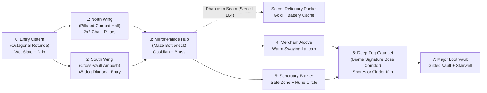

# Implementation Plan: Vibrant Multi-Biome Dungeon Architecture, Floor Plans & Eye Candy

## Goal Description

Today `Dark Dungeoneer` generates a deterministic `8`-node Directed Acyclic Graph (`Entry -> Combat A/B -> MirrorPalaceMaze -> Vendor / RestingGround -> DeepFogGauntlet -> MajorLootVault`) rendered with a single shared material per HISM component (`Floor_Tile0_D` for all floors, `Wall_Full0_D` for all walls) and uniform square rooms.

This plan outlines how to transform those rooms into a **vibrant, tactile, atmospheric 2.5D dungeon** rich with **subtle eye candy**, **distinct floor plan silhouettes**, and **four visually unmistakable biomes**—while respecting all repository constraints:
- **Zero `Tick` Heap Allocations**: All motes, flickering wall sconces, puddle highlights, and hazard vents use pre-allocated `UHierarchicalInstancedStaticMeshComponent` (HISM) buffers and pooled components (`<= 20` total draw calls for the entire floor geometry + eye candy).
- **Integrated GPU Budget (`Intel HD 520` Baseline)**: Dynamic flashlight shadows stay crisp while accent sconces, puddles, and ambient motes avoid expensive shadow maps, Lumen GI, and high-overdraw translucency.
- **100% Deterministic Seed Replication ([06-fog-relevancy-determinism.md](file:///c:/Users/Boris/Documents/antigravity/random-robby/.agents/rules/06-fog-relevancy-determinism.md))**: Every biome assignment, room silhouette, puddle cluster, sconce position, and secret Phantasm alcove derives exclusively from `FDungeonFloorSeed`.

---

## User Review Required

> [!IMPORTANT]
> **Two Technical Decisions Before Implementation**
> 1. **Per-Cell Material HISM Buckets vs. Custom HLSL UV-Atlas Shader**: Because our project bootstraps materials dynamically from PNG sheets in `C++` (`UDungeoneerAssetBootstrapSubsystem`) without requiring manual `.uasset` Material Graph authoring in Unreal Editor, this plan proposes extracting individual sub-tiles (`Puddle`, `MossStone`, `Obsidian`, `MagmaCracks`, `Pillar`, `Sconce`, `Rune`, `Chain`) and bucketing them into ~8 lightweight HISM components (`WetFloorHISM`, `HazardFloorHISM`, `PillarHISM`, `SconceHISM`, `AmbientMoteHISM`, `ForegroundParallaxHISM`) instead of requiring `.uasset` changes. Confirm if you want pure C++ runtime extraction kept self-contained this way.
> 2. **Additional `4x4` Art Sheets**: `Content/Art/Dungeon/` currently has `ATLAS_Dungeon_Floors_4x4`, `PROP_Dungeon_Walls_And_Cutaways_4x4`, `PROP_Mirror_Palace_Maze_4x4`, and `PROP_Breakables_And_Traps_4x4`. To deliver full visual contrast for Sanctuaries, Vendors, Obsidians, and Archways, we can either **(A)** unlock all unused rows (`Row 1–3`) of the 4 existing sheets first + generate `2` new priority sheets (`PROP_Resting_Ground_Sanctuary_4x4`, `PROP_Doors_And_Level_Transitions_4x4`), or **(B)** rely strictly on the 4 existing sheets + vertex/material tinting for now.

## Open Questions

1. **Pacing & Floor Size**: Should floors stay crisp & punchy (`8–10` rooms per floor + `1–2` hidden Phantasm alcoves, `~2–4` minutes per floor) or expand into wider multi-branch exploration wings (`12–16` rooms)?
2. **Biome Progression Mapping**: Do you prefer biomes to transition **per floor** (`Floor 1 = Sunken Crypt`, `Floor 2 = Obsidian Mirror-Palace / Spore Fens`, `Floor 3 = Cinder Kiln`) or **blend per wing within every floor** (e.g., Northern wing = Spore Fens, Center = Mirror-Palace, Deep Gauntlet = Cinder Kiln)?
3. **Interactive Trap Depth**: Should floor grates/vents strictly be atmospheric/warning cues + status hazards, or also allow triggering environmental traps (e.g., luring zombies into steam/ember vents)?

---

## 1. Floor Plan Design & Architectural Silhouettes

Currently [`UDungeonGeneratorSubsystem::GenerateFloorGraph`](file:///c:/Users/Boris/Documents/antigravity/random-robby/Source/DarkDungeoneer/Private/Dungeon/DungeonGeneratorSubsystem.cpp) places fixed square rooms along straight East-West (`+X`) rows. To make every floor feel bespoke and purposefully designed around our **4-axis (8-compass) locomotion**, we will upgrade the generator to mix room geometries, connector angles, and secret alcoves:



### Room Archetypes (`EDungeonRoomShape`)
Each `FDungeonNode` receives a deterministic `RoomShape` + `BiomeType` derived from `Node.RoomSeed`:

| Room Shape | Dimensions & Features | Where Used | 2.5D Locomotion Synergy |
| :--- | :--- | :--- | :--- |
| **`SquareChamber`** | `9x9` or `11x11` tiles with asymmetric doorway offsets | Standard Crypt & Vendor alcoves | Clean sightlines for flashlight sweeping |
| **`OctagonalRotunda`** | Chamfered **45° diagonal corners** built using `PROP_Dungeon_Walls` Row 3 corner wedges | Entry Chambers, Sanctuaries, Vaults | Directly rewards `NE/NW/SE/SW` diagonal movement without snagging |
| **`PillaredGallery`** | Wide `11x13` hall containing a `2x2` or `3x2` grid of freestanding chain pillars (`Row 3` cell `12–15`) | Combat branches & Deep Fog Gauntlets | Pillars cast dramatic dynamic flashlight shadows (`bCastShadow = true`) & kiting cover |
| **`CrossAmbushVault`** | Plus-shaped floor (`+`) with recessed alcoves hiding Exploders in fog pockets | Deep Fog Gauntlets & Combat B | Forces lateral flashlight sweeping across alcoves |
| **`SecretPhantasmPocket`** | `5x5` dead-end chamber attached to Mirror-Palace or Combat via an `AMirrorWall_Phantasm` (`Stencil 104`) false wall | Optional `1–2` per floor | Rewards players using Dark Vision or Reflected Mirror Beams to uncover hidden gold & batteries |

### 8-Compass Corridors (`45°` Diagonal & `Z`-Bend Connectors)
Instead of connecting every room solely with orthogonal right-angle Manhattan bends, [`ADungeoneerTileMapInstancer::BuildDungeonFromFloorGraph`](file:///c:/Users/Boris/Documents/antigravity/random-robby/Source/DarkDungeoneer/Private/Dungeon/DungeoneerTileMapInstancer.cpp) will support **45° diagonal corridor spans** lined with chamfered flagstones (`ATLAS_Dungeon_Floors_4x4` Row 2) and angled flanking walls (`WallAxisToYawDeg` ±45° / ±135°).

---

## 2. The Four Dungeon Biomes

All 4 biomes run cleanly on existing UE 5.8.2 subsystems (`ADungeonAtmosphereActor`, `UDungeoneerAssetBootstrapSubsystem`, `ADungeoneerTileMapInstancer`) and can be mixed across floors or wings:

| Biome (`EDungeonBiomeType`) | Floor / Wing Role | Floor & Wall Materials (`ATLAS_*` / `PROP_*`) | Atmosphere (`ADungeonAtmosphereActor`) | Subtle Eye Candy & Gameplay Hook |
| :--- | :--- | :--- | :--- | :--- |
| **1. Sunken Crypt** (`Crypt`) | Floor 1 & outer crypts | Dark slate flagstones (`Row 0`) + **35% shallow flooded puddle tiles** (`Row 1`, `Roughness = 0.05`); mossy/chained walls | `DrippingWater`: cool slate-blue fog (`Albedo (0.12, 0.18, 0.25)`), `Density 0.05` | Puddles reflect crisp orange/white streaks from player flashlights; ceiling water-drip ripples hit puddle tiles; iron wall sconces warm doorway thresholds |
| **2. Obsidian Mirror-Palace** (`MirrorPalace`) | Mid-floor convergence & Floor 2 core | Polished dark obsidian checkerboard + brass compass-rose inlays (`Row 2`); ornate `#00FF00` mirrors & rune phantasm panes | `ColdDrafts`: icy cyan-blue haze (`Albedo (0.15, 0.22, 0.32)`), subtle light scatter | Sharp specular floor sheen; grazing flashlight beams bounce off rotating prisms onto hidden illusion seams; shimmering ice-dust motes drift along mirror frames |
| **3. Blighted Spore Fens** (`SporeFens`) | Toxic branch wings & Deep Fog Gauntlets | Cracked toxic moss cobbles (`Row 3` cell `13`) + drainage grates; cracked mossy walls & alcoves | `ToxicSpores`: murky emerald fog (`Albedo (0.14, 0.28, 0.12)`), thick `Density 0.075` | Soft glowing chartreuse bioluminescent spore puffs rising from mossy grates; glowing poison thrower flasks cast green reflections on wet cracks |
| **4. Cinder Kiln / Ash Forge** (`EmberForge`) | Floor 3+ & Deep Gauntlet / Vault approaches | Scorched magma-veined stone (`Row 3` cell `12`), dark basalt borders, rusted chain pillars | `EmberAsh`: warm charcoal-amber fog (`Albedo (0.28, 0.14, 0.09)`), `Density 0.05` | Slow-rising orange cinder embers catching flashlight cones; warm pulsing crack seams under floor grates; scorched blast scars near Exploder patrols |

---

## 3. Subtle Eye Candy & Living Dungeon Systems

Everything below runs on **pre-allocated pooled components / single HISM batches** with zero per-frame heap allocations:

### A. Specular Wetness & Flashlight Contrast (Biggest Immediate Payoff)
- Currently `FloorHISM` uses `RoughnessVal = 0.72f` uniformly across every floor tile.
- **Upgrade**: Extract `Floor_Wet0..3` from `ATLAS_Dungeon_Floors_4x4` Row 1 (`Specular puddle` tiles) paired with its `_R` roughness channel (`0.05` on puddles, `0.78` on surrounding slate). Place `Floor_Wet*` tiles into a dedicated `WetFloorHISM` bucket (`Roughness = 0.08f`) scattered in organic 2–4 tile clusters and corridor drains.
- **Visual Result**: Even in pitch-black dungeons on Intel HD 520 (zero Lumen cost!), sweeping your flashlight or casting a `LanternSlash` ember wave lights up gleaming wet puddles across stone flagstones.

### B. Pooled Ambient Motes, Spores & Cinders (`AmbientMotesHISM`)
- Currently [`ADungeonAtmosphereActor`](file:///c:/Users/Boris/Documents/antigravity/random-robby/Source/DarkDungeoneer/Private/Rendering/DungeonAtmosphereActor.cpp) switches Niagara only when a `UNiagaraSystem*` asset is manually authored in Editor.
- **Upgrade**: Add a lightweight **pooled HISM billboard particle ring (`AmbientMotesHISM`, 64–96 instances)** inside `ADungeonAtmosphereActor` (or `ADungeoneerTileMapInstancer`) that re-positions instances deterministically around the local camera/player bounds using fast trigonometry (`Sin/Cos` phase per index):
  - **Crypt**: Faint pale-blue/silver falling water droplets & dust drifting downward through the flashlight cone.
  - **Mirror-Palace**: Shimmering gold/cyan crystal motes hovering beside mirror panes.
  - **Spore Fens**: Soft emerald-green fungal spores drifting upward lazily.
  - **Ember Forge**: Warm orange glowing ash embers floating slowly upward.
- **Cost**: `1` draw call (`bCastShadow = false`), `0` dynamic allocations in `Tick`.

### C. Flickering Doorway Sconces & Sanctuary / Vault Hero Lighting
- **Threshold Sconces (`SconceLightsPool` + `SconceHISM`)**: Pre-allocate `4` shadowless `UPointLightComponent`s (`CastShadows = false`, warm amber `FLinearColor(1.0f, 0.58f, 0.22f)`, tight `AttenuationRadius = 420 UU`) on `ADungeoneerTileMapInstancer` that smoothly track the **4 closest active room-threshold torches** to the camera and flicker subtly using layered deterministic sine waves (`0.88 + 0.12 * sin(t*7.3 + id) * cos(t*13.1)`).
- **Gameplay Purpose**: Gives players sparse, atmospheric visual breadcrumbing in pitch darkness ("There's an archway ahead in the fog!") without blowing Intel HD 520 shadow budgets.

### D. Foreground Depth Layer & Animated Props (`ForegroundParallaxHISM`)
- Place **ceiling beams, iron chains, and hanging cobweb silhouettes** (`PROP_Breakables_And_Traps_4x4` Row 3) at `Z = +260 UU` slightly outside South walls/corridor archways with `bCastShadow = false`. As the `-60°` camera pans, foreground chains glide past at higher parallax speed—instantly adding rich multi-plane depth to 2.5D scenes.
- **Ambient Prop Polish**:
  - Shattered crates/urns trigger brief radial floor-dust puffs using pooled decals/instances.
  - `ARestingGroundActor` animates gently pulsing blue/gold rune rings around its sanctuary boundary (`SanctuaryBounds`) so safe zones read effortlessly at a glance.
  - `AVendorActor` sways its hanging shop lantern gently (`Sin(Time)` roll) to differentiate merchants from dungeon walls.

### E. Dynamic Zone Atmosphere Blending
- Add lightweight per-tick smoothing in `ADungeonAtmosphereActor` (throttled every `0.10s`) that checks which `FDungeonNode` biome the active local player stands inside and smoothly interpolates `FogDensity`, `FogAlbedo`, and mote tint over `0.6s` when crossing from a cold Sunken Crypt into a warm Resting Sanctuary or emerald Spore Fen!

---

## Proposed File Changes

### Dungeon Data & Floor Plan Generator
#### [MODIFY] [DungeonTypes.h](file:///c:/Users/Boris/Documents/antigravity/random-robby/Source/DarkDungeoneer/Public/Dungeon/DungeonTypes.h)
- Add `EDungeonBiomeType` (`Crypt`, `MirrorPalace`, `SporeFens`, `EmberForge`).
- Add `EDungeonRoomShape` (`SquareChamber`, `OctagonalRotunda`, `PillaredGallery`, `CrossAmbushVault`, `SecretPhantasmPocket`).
- Extend `FDungeonNode` with `BiomeType`, `RoomShape`, `bIsSecretRoom`, and `WeatherPreset`.

#### [MODIFY] [DungeonGeneratorSubsystem.h](file:///c:/Users/Boris/Documents/antigravity/random-robby/Source/DarkDungeoneer/Public/Dungeon/DungeonGeneratorSubsystem.h) & [DungeonGeneratorSubsystem.cpp](file:///c:/Users/Boris/Documents/antigravity/random-robby/Source/DarkDungeoneer/Private/Dungeon/DungeonGeneratorSubsystem.cpp)
- Assign `BiomeType` deterministically per floor/branch + `RoomShape` per node archetype (Octagonal Entry/Vault, Pillared Combat Galleries, Cross Gauntlet, `1–2` Secret Phantasm Alcoves off Mirror/Combat rooms).

---

### Asset Bootstrap & Multi-Biome Tile Extraction
#### [MODIFY] [DungeoneerAssetBootstrapSubsystem.cpp](file:///c:/Users/Boris/Documents/antigravity/random-robby/Source/DarkDungeoneer/Private/Core/DungeoneerAssetBootstrapSubsystem.cpp)
- Expand `ExtractDefaultSingleCellTiles()` to cache unused rows already inside existing 4x4 sheets:
  - Floors (`ATLAS_Dungeon_Floors_4x4`): Row 0 Dry Slate (`Floor_Dry0..3`), Row 1 Wet Puddles (`Floor_Wet0..3`), Row 2 Octagonal/Compass Inlays (`Floor_Inlay0..3`), Row 3 Magma/Moss/Glass Hazards (`Floor_Hazard_Magma`, `Floor_Hazard_Moss`, `Floor_Hazard_Glass`).
  - Walls & Pillars (`PROP_Dungeon_Walls_And_Cutaways_4x4`): Row 2 Diagonal Wedges (`Wall_Diag0`), Row 3 Chain Pillars (`Wall_Pillar0`).
- *(Phase 2 Art)*: Generate `PROP_Doors_And_Level_Transitions_4x4` and `PROP_Resting_Ground_Sanctuary_4x4` via `image-generator` + `slice_normal_rig.py --mode dungeon`.

---

### Modular Multi-Bucket Instancer & Micro-Detail Juice
#### [MODIFY] [DungeoneerTileMapInstancer.h](file:///c:/Users/Boris/Documents/antigravity/random-robby/Source/DarkDungeoneer/Public/Dungeon/DungeoneerTileMapInstancer.h) & [DungeoneerTileMapInstancer.cpp](file:///c:/Users/Boris/Documents/antigravity/random-robby/Source/DarkDungeoneer/Private/Dungeon/DungeoneerTileMapInstancer.cpp)
- Add biome/feature HISM buckets (`WetFloorHISM`, `HazardFloorHISM`, `InlayFloorHISM`, `PillarHISM`, `SconceHISM`, `ForegroundParallaxHISM`) alongside `FloorHISM`, `WallHISM`, `MirrorHISM`, `BreakableHISM`.
- Carve `OctagonalRotunda` corners with 45° diagonal wedges, spawn `2x2` / `3x2` pillars in `PillaredGallery` nodes, scatter organic wet puddle clusters + mossy/ember border tiles per biome, and attach secret Phantasm doors guarding bonus loot/gold breakables.
- Pre-allocate `4` shadowless `UPointLightComponent` sconce lights that relocate smoothly to the closest threshold sconces around the player camera with deterministic sine-flicker intensity.

---

### Living Atmosphere, Pooled Ambient Motes & Visual Polish
#### [MODIFY] [DungeonAtmosphereActor.h](file:///c:/Users/Boris/Documents/antigravity/random-robby/Source/DarkDungeoneer/Public/Rendering/DungeonAtmosphereActor.h) & [DungeonAtmosphereActor.cpp](file:///c:/Users/Boris/Documents/antigravity/random-robby/Source/DarkDungeoneer/Private/Rendering/DungeonAtmosphereActor.cpp)
- Add pre-allocated `AmbientMotesHISM` (`64` camera-facing drifting motes/embers/spores/droplets updated in a fixed zero-allocation loop) + smooth `0.6s` volumetric fog color/density transitions across biomes and Sanctuary safe zones.

#### [MODIFY] [DungeonEncounterActors.cpp](file:///c:/Users/Boris/Documents/antigravity/random-robby/Source/DarkDungeoneer/Private/Dungeon/DungeonEncounterActors.cpp)
- Add campfire flicker + rotating sanctuary rune floor halo on `ARestingGroundActor`, gently swaying lantern animation on `AVendorActor`, and subtle golden pulse beacon on `AMajorLootVaultActor`.

#### [MODIFY] [DungeoneerGameMode.cpp](file:///c:/Users/Boris/Documents/antigravity/random-robby/Source/DarkDungeoneer/Private/Core/DungeoneerGameMode.cpp)
- Spawn/bind `ADungeonAtmosphereActor` in `StartPlay()` and synchronize its biome preset dynamically during `AdvanceToNextDungeonFloor()` and room transitions.

---

## Verification Plan

### Automated Verification
1. **Static Architecture & Zero-Tick-Allocation Gate**:
   ```powershell
   python scripts/verify_architecture_invariants.py
   ```
   Confirms zero heap allocations (`SpawnActor`, `NewObject`, `CreateDynamicMaterialInstance`) inside any `Tick` body and valid `AssetManifest.json` SHA-256 hashes.
2. **UnrealBuildTool Compilation**:
   ```powershell
   & "D:\epuc\UE_5.8\Engine\Build\BatchFiles\Build.bat" DarkDungeoneerEditor Win64 Development -Project="c:\Users\Boris\Documents\antigravity\random-robby\DarkDungeoneer.uproject" -WaitMutex -NoHotReloadFromIDE
   & "D:\epuc\UE_5.8\Engine\Build\BatchFiles\Build.bat" DarkDungeoneer Win64 Development -Project="c:\Users\Boris\Documents\antigravity\random-robby\DarkDungeoneer.uproject" -WaitMutex -NoHotReloadFromIDE
   ```
3. **Headless UE 5.8.2 Automation Suite (`DungeoneerVerificationSpecs.cpp`)**:
   - Expand tests to assert deterministic multi-biome generation (`Crypt`, `MirrorPalace`, `SporeFens`, `EmberForge`), `OctagonalRotunda` 45° diagonal wedge counts, `PillaredGallery` interior pillars, `WetFloorHISM` puddle instances, `SecretPhantasmPocket` reachability, and `ADungeonAtmosphereActor` zero-alloc mote tick updates:
   ```powershell
   & "D:\epuc\UE_5.8\Engine\Binaries\Win64\UnrealEditor-Cmd.exe" "c:\Users\Boris\Documents\antigravity\random-robby\DarkDungeoneer.uproject" -ExecCmds="Automation RunTests DarkDungeoneer; Quit" -Unattended -NullRHI -NoSplash -NoSound -TestExit="Automation Test Queue Empty" -AbsLog="c:\Users\Boris\Documents\antigravity\random-robby\Saved\Logs\AutomationTests.log"
   ```

### Manual Playtest Verification
- Launch via `Launch-DarkDungeoneer.bat` (`1280x720`, Intel HD 520 profile).
- Walk from `Entry` (`OctagonalRotunda`, Sunken Crypt) through `Combat` (`PillaredGallery`), sweeping the flashlight across wet puddle streaks, flickering doorway sconces, drifting motes, and foreground ceiling chains.
- Enter the `MirrorPalace` hub, trigger reflected beam reveal on a hidden `Phantasm` alcove seam, clear the `SporeFens`/`EmberForge` Gauntlet, unlock the Vault, and descend to Floor 2 to confirm instant visual biome/atmosphere transition.
