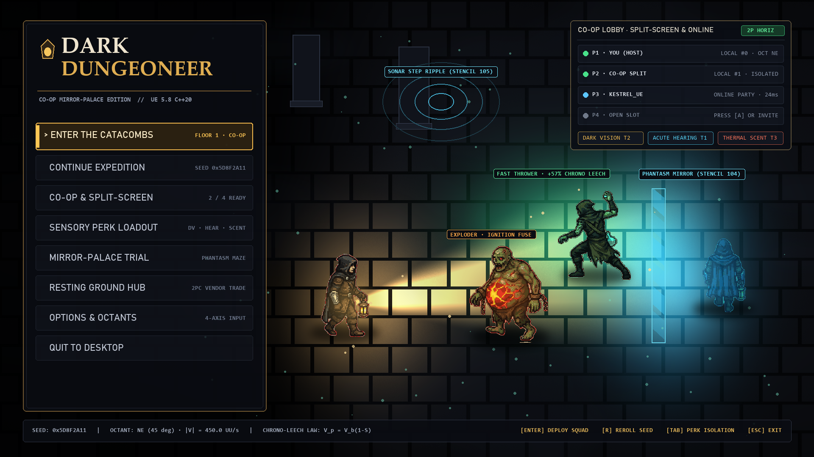

# Dark Dungeoneer — Main Menu Concept & UI Specification

This document defines the target visual layout and Unreal Engine 5.8 (`UMG` / `CommonUI`) widget boundaries for the **Dark Dungeoneer** main menu and co-op lobby.

*(An interactive HTML browser prototype of the multi-tab lobby/perk/seed/trade workflows is also stored at [assets/dark_dungeoneer_menu_mockup.html](assets/dark_dungeoneer_menu_mockup.html).)*

---

## 1. Visual Aesthetic & Stage Composition (`1920×1080` Target)

| Screen Region | Role | Gameplay / C++ Link |
| :--- | :--- | :--- |
| **Left Panel (`x: 54..628`)** | Wrought-iron & tarnished brass `DARK DUNGEONEER` header, lantern crest badge, and 8 navigation buttons. Active selection uses a warm amber edge bar (`> ENTER THE CATACOMBS`). | Bound to `UCommonActivatableWidget` stack + `ADungeoneerGameMode` launch parameters. |
| **Center-Right Stage (`x: 630..1860`)** | Real-time `-60°` top-down 2.5D diorama rendered behind the UI using `M_25D_PixelLit` cobblestones, volumetric distance fog, and floating Niagara spore emitters. | Driven by a menu-level `AMenuDioramaStageActor` reusing Hero, Exploder, and Fast Thrower normal-mapped rigs. |
| **Dynamic Stage Props** | Hero narrow-beam `USpotLightComponent` cone illuminates an `AZombieExploder` (`IgnitionRadius` orange pulse), an `AZombieFastThrower` in jade `Chrono-Gas`, an `AMirrorWall_Phantasm` (`CustomDepthStencil = 104`) with cyan decoy projection, and `CustomDepthStencil = 105` acoustic sonar rings. | Directly mirrors live in-game stencil channels (`101` Solid Mirror, `104` Phantasm, `105` Hearing Ring, `106` Decoy). |
| **Top-Right Card (`x: 1345..1866`)** | Compact obsidian Co-Op Lobby card displaying up to 4 party slots (`P1 LOCAL #0`, `P2 LOCAL #1`, `ONLINE PARTY`, `OPEN SLOT`), live split-screen mode badge (`2P HORIZ`), and per-viewport Sensory Perk badges (`DARK VISION T2`, `ACUTE HEARING T1`, `THERMAL SCENT T3`). | Polls `UDungeoneerGameViewportClient`, `UDungeoneerLocalPlayerSubsystem`, and `UDungeoneerSocialSubsystem` (zero `GetFirstPlayerController()`). |
| **Bottom Strip (`y: 992..1044`)** | Deterministic floor telemetry (`SEED`, current 8-compass octant & scalar speed, Chrono-Leech conservation readout) and controller/keyboard action hints (`[ENTER]`, `[R]`, `[TAB]`, `[ESC]`). | Reads `UDungeonGeneratorSubsystem` seed stream and binds Enhanced Input menu actions. |

---

## 2. Implementation Mapping

Detailed engineering tickets turning each region into UE 5.8 C++20 `UUserWidget` / `UCommonActivatableWidget` classes live in [`TASKS.md`](TASKS.md) under milestone **`v0.8.0` (`TASK-801` – `TASK-804`)**.
